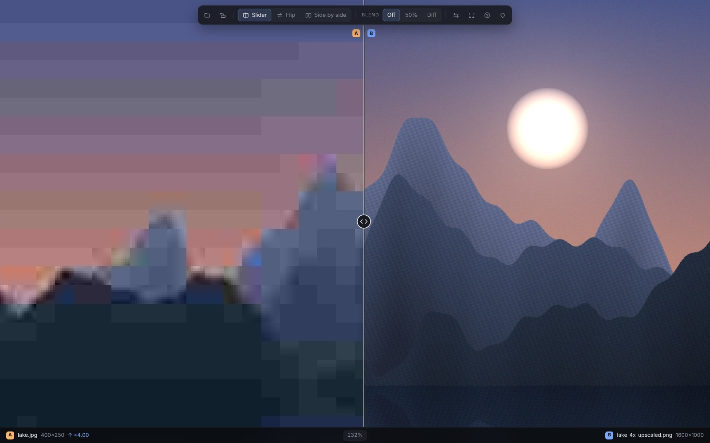
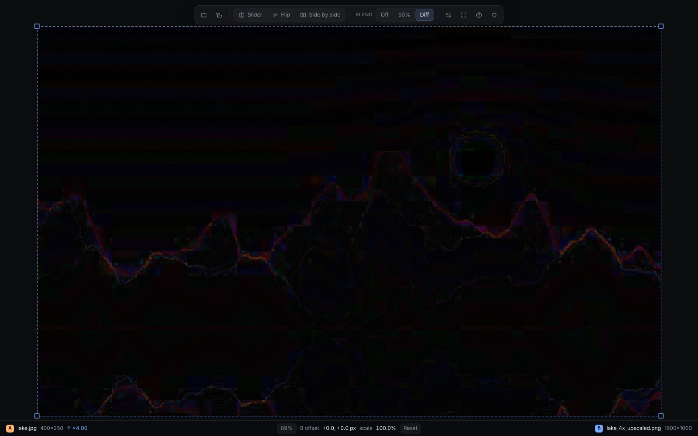
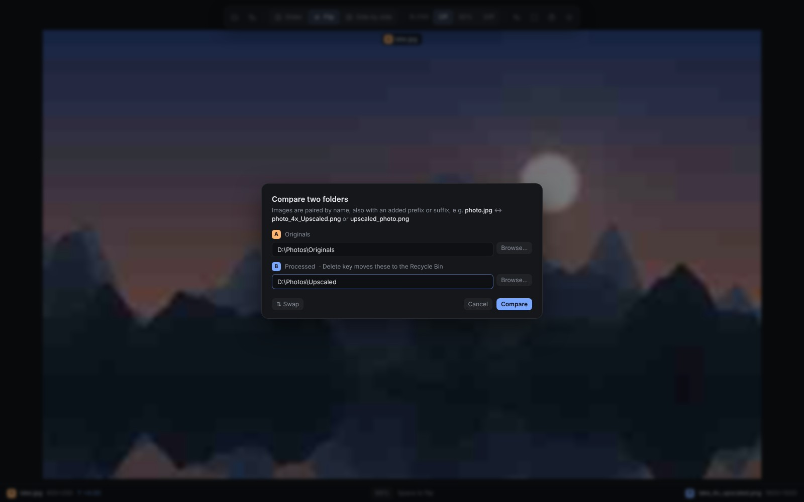
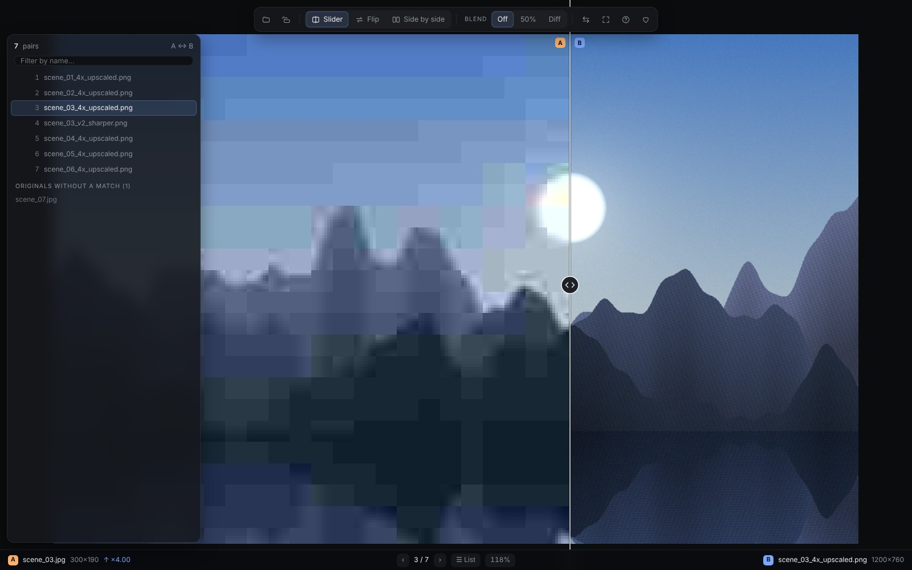

# Compare Viewer

**A fast, minimal, dark-mode image comparison app for Windows. Free and fully local.**

Compare Viewer shows two images on top of each other, so you can see exactly what changed between
an original and an edited, upscaled, restored or compressed version. Flip between them, drag a
slider across, view them side by side, or show the pixel difference. You can also compare **whole
folders** of originals and processed images pair by pair, and delete the processed versions you
don't want to keep.

- 🔒 **100% local.** Nothing is uploaded, and the app needs no internet connection.
- 🆓 **Freeware.** Free for personal and commercial use, with no ads, no tracking and no time
  limits. See [LICENSE.txt](LICENSE.txt).
- 🪶 **Lightweight.** A single small `.exe`, using the Microsoft Edge WebView2 engine built into Windows.

*Slider mode: a low-resolution JPEG (A) against a 4× upscaled version (B).*

Version **1.04** · by **Stefan Karlsson**

---

## Contents

- [Requirements](#requirements)
- [Installation](#installation)
- [Opening images](#opening-images)
- [Comparison modes](#comparison-modes)
- [Blend modes and alignment](#blend-modes-and-alignment)
- [Different image sizes](#different-image-sizes)
- [Zoom and pan](#zoom-and-pan)
- [Folder compare](#folder-compare)
- [Deleting processed images](#deleting-processed-images)
- [Right-click menu in Windows Explorer](#right-click-menu-in-windows-explorer)
- [Keyboard and mouse reference](#keyboard-and-mouse-reference)
- [Supported formats](#supported-formats)
- [Tips](#tips)
- [Privacy and security](#privacy-and-security)
- [Troubleshooting](#troubleshooting)
- [How it works](#how-it-works)
- [Support the project](#support-the-project)
- [License and credits](#license-and-credits)
- [Version history](#version-history)

---

## Requirements

- Windows 10 or 11 (64-bit)
- **Microsoft Edge WebView2 Runtime.** It is preinstalled on Windows 11 and on most Windows 10
  computers. If the app opens as an empty window, install it from Microsoft's WebView2 page.

Everything else the app needs is built into `CompareViewer.exe`.

## Installation

1. Download the release and unzip it to a folder of your choice, for example
   `D:\Program_D\Compare Viewer\`.
2. Double-click **`CompareViewer.exe`**. There is no installer, and nothing is written to the
   system.
3. *(Optional)* Add the right-click menu entries: see
   [Right-click menu in Windows Explorer](#right-click-menu-in-windows-explorer).

> **Windows SmartScreen:** because the app is free and not code-signed, Windows may show
> *"Windows protected your PC"* the first time. Click **More info → Run anyway**.

---

## Opening images

Compare Viewer compares **two images**: **A** (shown with an orange tag) and **B** (blue tag).

| Method | How |
|---|---|
| **Drag and drop** | Drop two images on the window. When both images are loaded, dropping a single image on the **left half** replaces A and on the **right half** replaces B. |
| **Open dialog** | Click the **open button** (first in the toolbar), or press **Ctrl + O**, and select two images. |
| **Right-click in Explorer** | Select two images → right-click → **Open in Compare Viewer** (after adding the menu entries). |
| **Drag onto the exe** | Drag two images onto `CompareViewer.exe` or a shortcut to it. |
| **Command line** | `CompareViewer.exe original.jpg processed.png` |

**Which image becomes A?** Images are sorted by name **without the extension**, so the original
normally becomes A: `photo.jpg` is A and `photo_4x_upscaled.png` is B. Press **X** to swap them.

**One window only.** If Compare Viewer is already open, images you open from Explorer go into
that window instead of starting a new one. Opening a single image while a pair is shown replaces B.

---

## Comparison modes

Choose a mode in the toolbar or with the number keys. **Flip** is the default.

### 🔁 Flip (2)
Shows A or B in the same place. **Tap Space** to switch between them. This is the best way to
spot small differences, because your eye catches the change. A label at the top shows which image
you are looking at.

### 🎚️ Slider (1)
A on the left, B on the right, split by a divider. **Click or drag anywhere** in the image to move
the divider.

### ◫ Side by side (3)
A and B next to each other. Zoom and pan are **synchronized**, so both panes always show the
same area.

---

## Blend modes and alignment

The **Blend** buttons (or the **B** key, which cycles through them) lay B on top of A:

| Blend | What you see |
|---|---|
| **Off** | The normal comparison modes above |
| **50%** | B at 50% opacity over A. Good for checking alignment and ghosting. |
| **Diff** | The **difference** between A and B. Black means identical, and anything bright is a change. Ideal for seeing exactly what a filter or AI model altered. |

*Diff mode: only the places where A and B differ light up.*

### Aligning B to A
In 50% and Diff mode, B can be moved and resized, for example when a processed image was cropped
or shifted slightly:

| Action | How |
|---|---|
| Move B | Drag inside B |
| Resize B (aspect kept) | Drag a corner handle |
| Resize B freely | Hold **Shift** while dragging a corner |
| Fine-scale B at the cursor | **Alt + scroll** |
| Nudge B by 1 px | **Arrow keys** (**Shift** = 10 px) |
| Reset alignment | **R**, or the **Reset** button in the status bar |

The status bar shows B's current offset and scale.

---

## Different image sizes

If A and B have different sizes, the **smaller image is scaled up to match the larger one**, so
the two always line up. The status bar shows the scale factor, for example `↑ ×2.11` for a
1024 px original compared with a 2160 px upscale.

Both images are **automatically fitted** to the window when you open them.

---

## Zoom and pan

| Action | How |
|---|---|
| Zoom in or out at the cursor | **Scroll wheel** |
| Zoom in (Photoshop-style steps) | **Space + Ctrl + click** |
| Zoom out (Photoshop-style steps) | **Space + Alt + click** |
| Zoom in or out at the centre | **Ctrl + =** / **Ctrl + −** |
| Pan | **Space + drag**, **right-drag** or **middle-drag** |
| Pan with the wheel | **Ctrl + scroll** (add **Shift** for sideways) |
| Pan with the keyboard | **Arrow keys** (**Shift** = bigger steps). In folder compare, ← and → change pair instead; **Shift + ← →** still pans. |
| Fit to window | **F**, **Ctrl + 0**, **double-click**, or the fit button |
| Actual pixels (100%) | **Z** |
| Toggle fit / 100% | Click the zoom percentage in the status bar |

Photoshop-style zoom uses the familiar steps (…, 50%, 66.7%, 100%, 200%, 300%, …, 6400%).
When you zoom in far, pixels are shown sharp and square instead of smoothed, so you can inspect
single pixels.

**Space is shared:** a quick **tap** flips A/B, while **holding** it turns on the zoom and pan tool,
just like in Photoshop.

---

## Folder compare

Compare a folder of **originals** with a folder of **processed** images, for example the input and
output of an upscaler, a batch edit or an AI restoration model.

### Starting

- Click the **folder compare button** in the toolbar (two folders), press **Ctrl + Shift + O**, or
  click **Compare two folders…** on the start screen.
- Choose **A: Originals** and **B: Processed** with **Browse…**, or paste the folder paths.
  **⇅ Swap** exchanges them.
- Click **Compare** (or press **Enter**).

You can also select **both folders in Explorer → right-click → Compare folders in Compare
Viewer**. The app works out by itself which folder holds the originals, from the added prefixes
or suffixes. (If the names are identical in both folders it can't tell, so use the dialog and pick
A and B yourself.) If you right-click a single folder, the folder dialog opens with it as A, so
you can pick the processed folder.

### How images are paired
Files are paired **by name**. Case and file extension don't matter. A processed file matches an
original when it has the **same name**, or the original's name with an **added prefix or suffix**:

| Original (A) | Processed (B) | Paired? |
|---|---|---|
| `photo.jpg` | `photo.png` | ✅ same name |
| `photo.jpg` | `photo_4x_Remacri_Upscaled.jpg` | ✅ suffix |
| `photo.jpg` | `upscaled_photo.png` | ✅ prefix |
| `photo.jpg` | `v2-photo-final.webp` | ✅ prefix and suffix |
| `img1.jpg` | `img10_upscaled.png` | ❌ correct: `img10` is a different image |

- The prefix or suffix must be separated by one of: `_` `-` `.` space `(` `)` `[` `]` `{` `}` `+` `,` `~`
- If several originals could match, the **longest** name wins.
- One original can have **several processed versions** (for example from different models). Each
  one becomes its own pair.
- Only images **directly inside** the two folders are used, not images in subfolders.
- Pairs are sorted naturally by name (`2` comes before `10`).

### Browsing the pairs
| Action | How |
|---|---|
| Next / previous pair | **→ / ←**, **Page Down / Page Up**, or the **‹ ›** buttons in the status bar |
| First / last pair | **Home / End** |
| Pair list | **L**, or the **☰ List** button |

- The status bar shows your position, for example **15 / 1553**.
- **Your zoom and position are kept** when you move to the next pair, as long as the images
  are the same size. Zoom in on an eye once and step through hundreds of images at the same spot.
- Your comparison mode, blend mode and swap (**X**) also stay when you change pairs. Blend
  alignment (moving or resizing B) resets for each new pair.
- The neighbouring pairs are loaded in advance, so stepping through is fast.

### The pair list

*Folder compare: 7 pairs, the list shows one original without a match.*

Press **L** to open a list of all pairs. Type in the **filter** box to find files by name, and
click a row to jump to it. At the bottom, the list also shows **originals without a match** and
**processed images without a match**, so you can see what's missing.

---

## Deleting processed images

In folder compare, press **Delete** to remove the current **processed image (B)**. This is
handy for sorting out bad results while you review a batch.

- The file is moved to the **Windows Recycle Bin**, so you can restore it from there.
- The first time, a dialog shows the **full path** of the file. Press **Enter** to
  confirm, or **Esc** to cancel. Tick **"Don't ask again until I close the app"** for fast cleanup.
- After deleting, the next pair is shown.
- **Originals (A) are never deleted**, even if you have swapped the display with **X**.
- Delete only works in folder compare, never on images opened one by one.

---

## Right-click menu in Windows Explorer

The release includes two registry files:

| File | What it does |
|---|---|
| `Add_CompareViewer_ContextMenu.reg` | Adds **Open in Compare Viewer** for images and **Compare folders in Compare Viewer** for folders |
| `Remove_CompareViewer_ContextMenu.reg` | Removes both entries again |

Double-click the file and confirm. The entries are added **for your user only**, so no
administrator rights are needed.

> **Important:** the `.reg` file points to `D:\Program_D\Compare Viewer\CompareViewer.exe`. If
> you put the app somewhere else, open the `.reg` file in Notepad and change every path first
> (use double backslashes `\\`, as in the file).

On **Windows 11**, the entries are under **Show more options** (or **Shift + right-click**).

---

## Keyboard and mouse reference

Press **?** or **H** in the app to show this list.

### View
| Key | Action |
|---|---|
| **Space** (tap) | Flip between A and B |
| **1 · 2 · 3** | Slider · Flip · Side by side |
| **B** | Cycle blend: Off · 50% · Diff |
| **X** | Swap A and B |
| **F** · **Ctrl + 0** · double-click | Fit to window |
| **Z** | Actual pixels (100%) |
| **Ctrl + = / Ctrl + −** | Zoom in / out |
| **Ctrl + O** | Open images |
| **Ctrl + Shift + O** | Compare two folders |
| **? / H** | Show or hide the shortcut list |
| **Esc** | Close panels and dialogs |

### Mouse
| Action | Result |
|---|---|
| Scroll | Zoom at the cursor |
| Ctrl + scroll | Pan (Shift for sideways) |
| Space + Ctrl + click | Zoom in, Photoshop steps |
| Space + Alt + click | Zoom out, Photoshop steps |
| Space + drag · right-drag · middle-drag | Pan |
| Click or drag (Slider mode) | Move the divider |

### Blend alignment (50% and Diff)
| Key / action | Result |
|---|---|
| Drag B | Move |
| Drag a corner | Resize, aspect kept (Shift = free) |
| Alt + scroll | Fine-scale at the cursor |
| Arrow keys | Nudge 1 px (Shift = 10 px) |
| R | Reset alignment |

### Folder compare
| Key | Action |
|---|---|
| **← → · Page Up / Page Down** | Previous / next pair (in blend mode the arrows nudge B, so use Page Up / Page Down) |
| **Home · End** | First / last pair |
| **L** | Pair list with filter |
| **Delete** | Move B (processed) to the Recycle Bin |

---

## Supported formats

PNG, JPEG (`.jpg`, `.jpeg`, `.jpe`, `.jfif`), WebP, AVIF, BMP and GIF (shown as a still image).

---

## Tips

- **Judging AI upscalers or restoration models:** use **Flip** at **100% (Z)** on faces, hair and
  text, then **Diff** to see where the model added or removed detail.
- **Reviewing a large batch:** open the folders, zoom in on an important area once, then step
  through with **→** and press **Delete** on the failures.
- **Comparing several models:** save each model's output in its own folder and compare each
  folder with the originals. Or put the outputs in one folder: every version gets its own pair
  with the same original.
- **Original vs upscale with different sizes:** no preparation needed. The smaller image is
  scaled to match automatically.

---

## Privacy and security

- All images are processed **on your computer**. Nothing is uploaded and nothing is tracked.
- To load large images quickly, the app runs a small image server that only listens on
  **127.0.0.1** (your own computer), uses a **random secret token**, and only serves the files
  you opened.
- To keep a single window, the app listens on local port **47613** (127.0.0.1 only).
- The window runs in private mode: no browsing data is stored.
- The only internet link is the optional **♥ Support** button, which opens the donation page in
  your normal browser.
- Deleting always goes to the **Recycle Bin**, never straight to permanent deletion.

---

## Troubleshooting

| Problem | Solution |
|---|---|
| "Windows protected your PC" | The app is not code-signed. Click **More info → Run anyway**. |
| The window stays empty | Install or repair the **Microsoft Edge WebView2 Runtime**. |
| No right-click entry | Run `Add_CompareViewer_ContextMenu.reg`. Check that the path in it matches where `CompareViewer.exe` is. On Windows 11, look under **Show more options**. |
| Right-clicking two images opens two windows | Another program is using port 47613. Close it, or open both images in one go with drag and drop. |
| "No matching file names found" | Check that you picked the right folders, and that the processed names contain the original names (see [How images are paired](#how-images-are-paired)). Images in subfolders are not included. |
| Space does nothing | Click on the image first, so the window has keyboard focus (not a text field). |
| Delete does nothing | Delete only works in folder compare. |

---

## How it works

- **User interface:** the interface draws the images on an HTML canvas. Zoom, pan, blending (the
  canvas `difference` mode) and alignment all happen on the GPU-accelerated canvas.
- **Window:** [pywebview](https://pywebview.flowrl.com/) shows the interface in a native window
  using the Microsoft Edge **WebView2** engine.
- **Image loading:** images are served from a local, token-protected server on 127.0.0.1, so
  large files load at full speed without being converted.
- **Single instance:** a second launch sends its files or folders to the open window over a local
  socket (port 47613) and exits. Windows starts the program once per selected file, so this is
  what makes a multi-selection open in **one** window.
- **Folder pairing:** names are compared without extensions and case, at separator boundaries,
  with the longest match winning.
- **Recycle Bin:** deletion uses the Windows shell (`SHFileOperation` with undo enabled).
- **Native build:** the app is compiled to native machine code, and everything it needs is
  built into the single `CompareViewer.exe`.

---

## Support the project

Compare Viewer is free, and it will stay free. If it saves you time, a small donation is very
welcome and helps further development:

### ♥ [paypal.me/gazeomatic](https://paypal.me/gazeomatic)

You can also use the **♥** button in the app's toolbar or help panel.

---

## License and credits

Compare Viewer is **freeware**:

| ✅ You may | ❌ You may not |
|---|---|
| Use it for free, privately and commercially, on any number of computers | Sell it or charge for it |
| Share the complete, unchanged zip for free | Modify, repackage or reverse engineer it |

See [LICENSE.txt](LICENSE.txt) for the full license.

Copyright © 2026 **Stefan Karlsson**

Built with:
- [pywebview](https://pywebview.flowrl.com/) (BSD 3-Clause)
- [Python](https://www.python.org/) (PSF License)
- [Nuitka](https://nuitka.net/) (Apache 2.0) to compile the release build
- Microsoft Visual C++ Runtime (included, redistributed under Microsoft's Visual Studio terms)
- Microsoft Edge WebView2 (part of Windows, not included in the download)

The full license texts of all bundled components are in `THIRD_PARTY_LICENSES.txt`, which is
included with every release.

---

## Version history

### 1.04
- **Folder compare:** pair two folders of originals and processed images by name, with prefix
  and suffix matching, a pair list with filter, and unmatched files listed.
- **Delete key:** move processed images to the Recycle Bin, with a confirmation dialog.
- **Right-click on two folders** to compare them, with automatic detection of which folder holds
  the originals.
- Zoom and position are kept between pairs of the same size.
- Version number and author in the window title, help panel and exe properties.
- **♥ Support** button.
- Released as freeware.
